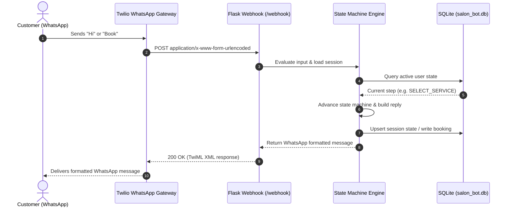

<div align="center">

<a href="https://github.com/biswashrai04-sudo/hair-by-pannu-bot">
  
</a>

# Hair by Pannu — WhatsApp Booking Bot

**Production-Grade Conversational Booking System for Mobile Salon Services in Abu Dhabi**

*Flask · Twilio WhatsApp API · SQLite · Gunicorn · State-Machine Architecture*

[](https://opensource.org/licenses/MIT)
[](https://www.python.org/)
[](https://palletsprojects.com/p/flask/)
[](https://www.twilio.com/whatsapp)
[](https://www.sqlite.org/)
[](https://render.com)
[](https://github.com/biswashrai04-sudo/hair-by-pannu-bot/pulls)

[📖 Documentation](#-documentation) · [🚀 Quickstart](#-quickstart) · [🏗 Architecture](#-system-architecture) · [🐛 Report Bug](https://github.com/biswashrai04-sudo/hair-by-pannu-bot/issues) · [✨ Request Feature](https://github.com/biswashrai04-sudo/hair-by-pannu-bot/issues)

</div>

---

## Overview

**Hair by Pannu Bot** is a complete, production-grade conversational WhatsApp bot built for a premium mobile hair styling business in **Abu Dhabi, UAE**. It orchestrates a friction-free customer journey entirely through WhatsApp:

- **Real-time service catalog** with pricing & duration
- **Conversational booking flow** with custom date/time/location
- **Abu Dhabi area coverage** validation (islands, villas, communities)
- **SQLite persistence** for sessions & confirmed appointments
- **Admin REST API** for booking management
- **Health checks** for container orchestration

> **Live Demo:** Deployed on Render at `https://pannu-bot.onrender.com` (configure Twilio webhook to `/webhook`)

---

## System Architecture



### State Machine (7 Steps)

| Step | Name | Action |
|------|------|--------|
| `0` | `IDLE` | Welcome + service menu |
| `1` | `SELECT_SERVICE` | Choose 1 of 6 treatments |
| `2` | `INPUT_DATE` | Date (YYYY-MM-DD, DD/MM/YYYY, "Tomorrow") |
| `3` | `INPUT_TIME` | Time slot (10AM, 1PM, 4PM, 7PM or custom) |
| `4` | `INPUT_NAME` | Customer full name |
| `5` | `INPUT_ADDRESS` | Abu Dhabi villa/community address |
| `6` | `CONFIRM_BOOKING` | Review + `YES` / `CANCEL` |

---

## Features

| Category | Capabilities |
|----------|--------------|
| **Services** | 6 treatments (Cut, Color, Keratin, Spa, Bridal, etc.) with AED pricing & duration |
| **Coverage** | 9 Abu Dhabi areas (Al Reem, Saadiyat, Yas, Al Raha, Khalifa City, Downtown, Corniche, Al Maryah, MBZ City) |
| **Date Parsing** | `YYYY-MM-DD`, `DD/MM/YYYY`, `DD-MM-YYYY`, `Tomorrow`, `Today` |
| **Time Slots** | 10AM, 1PM, 4PM, 7PM + custom 9AM–8PM |
| **Booking Ref** | Unique `HBP-XXXXXX` code per appointment |
| **Global Commands** | `MENU`, `COVERAGE`, `CANCEL`, `RESET`, `STOP` anytime |
| **Persistence** | SQLite sessions + appointments (indexed, ACID) |
| **Admin API** | `GET /api/bookings?status=CONFIRMED` |
| **Health Check** | `GET /health` for container probes |
| **TwiML Response** | Native WhatsApp formatting via Twilio SDK |

---

## Quickstart

### Prerequisites
- Python 3.10+
- Twilio Account + WhatsApp Sandbox/Business number
- Render/Vercel/Cloud Run for deployment (or VPS)

### Local Development

```bash
# 1. Clone
git clone https://github.com/biswashrai04-sudo/hair-by-pannu-bot.git
cd hair-by-pannu-bot

# 2. Create virtual environment
python3 -m venv venv
source venv/bin/activate

# 3. Install dependencies
pip install -r requirements.txt

# 4. Configure environment
cp .env.example .env
# Edit .env with your values:
# PORT=5000
# DATABASE_PATH=salon_bot.db
# LOG_LEVEL=INFO

# 5. Run
python app.py
# Server starts at http://localhost:5000
```

### Environment Variables

| Variable | Required | Default | Description |
|----------|----------|---------|-------------|
| `PORT` | No | `5000` | HTTP port |
| `HOST` | No | `0.0.0.0` | Bind address |
| `DATABASE_PATH` | No | `salon_bot.db` | SQLite file path |
| `LOG_LEVEL` | No | `INFO` | `DEBUG`, `INFO`, `WARNING`, `ERROR` |

### Twilio Webhook Configuration

1. In Twilio Console → Messaging → Try it out → Send a WhatsApp message
2. Set **Webhook URL** to: `https://your-domain.com/webhook`
3. Method: `POST`
4. Test with "Hi" → should receive welcome + service menu

---

## Deployment (Render — Free Tier)

```bash
# 1. Push to GitHub
git push origin main

# 2. Create new Web Service on Render
# - Build Command: pip install -r requirements.txt
# - Start Command: gunicorn app:app
# - Add Environment Variables (same as above)

# 3. Configure Twilio webhook to: https://your-app.onrender.com/webhook

# 4. Deploy → Live in ~2 minutes
```

> **Health Check:** Render automatically uses `GET /health` for liveness.

---

## Project Structure

```text
hair-by-pannu-bot/
├── app.py                 # Single-file Flask app (webhook, state machine, DB, API)
├── requirements.txt       # flask, requests, gunicorn
├── test_bot.sh           # Integration test script
├── .gitignore            # Python/Flask ignores
├── LICENSE               # MIT
└── README.md             # This file
```

> **Note:** Single-file architecture for simplicity. For larger teams, consider splitting into `routes/`, `services/`, `models/`, `state_machine/`.

---

## API Reference

### `GET /health`
Liveness probe.
```json
{
  "status": "healthy",
  "database": "connected",
  "timestamp": "2026-11-03T03:28:00.123456"
}
```

### `POST /webhook`
Twilio WhatsApp webhook (form-encoded or JSON).
- **Form fields:** `From` (phone), `Body` (message)
- **Returns:** TwiML XML

### `GET /api/bookings?status=CONFIRMED`
Admin endpoint — list appointments.
```json
{
  "total": 42,
  "appointments": [
    {
      "booking_ref": "HBP-A1B2C3",
      "customer_phone": "971501234567",
      "customer_name": "Aisha Al Mansoori",
      "service_name": "Balayage & Full Color",
      "price_aed": 550,
      "appointment_date": "2026-11-15",
      "appointment_time": "04:00 PM",
      "location_address": "Villa 14, Al Reem Island",
      "status": "CONFIRMED",
      "created_at": "2026-11-03T03:28:00"
    }
  ]
}
```

---

## Testing

```bash
# Run full integration test suite (requires deployed URL)
chmod +x test_bot.sh
./test_bot.sh
```

Tests:
1. Health check
2. Webhook response (simulated "Hi")
3. Structured booking endpoint
4. Bookings list
5. Admin dashboard

---

## Extending the Bot

### Add a New Service
Edit `SALON_SERVICES` dict in `app.py`:
```python
"7": {"name": "Men's Haircut & Beard Trim", "price_aed": 150, "duration": "45 mins"}
```

### Add Coverage Area
Edit `COVERAGE_AREAS` list:
```python
COVERAGE_AREAS.append("Al Reef Downtown")
```

### Customize State Machine
Modify `handle_incoming_message()` — each `STATE_*` block handles one step. Add new states by:
1. Defining `STATE_NEW_STEP = "NEW_STEP"`
2. Adding branch in dispatcher
3. Creating transition logic

### Add Persistence Layer
For PostgreSQL/MySQL: swap `get_db_connection()` to use `psycopg2`/`pymysql` + connection pooling.

---

## Security

- **No secrets in code** — all config via environment variables
- **`.gitignore`** blocks `.env`, `*.db`, `__pycache__`, venvs
- **Twilio signature validation** — add `RequestValidator` for production
- **Rate limiting** — consider `Flask-Limiter` for public endpoints
- **Input sanitization** — all user input validated in state handlers

---

## Contributing

1. Fork the repository
2. Create feature branch: `git checkout -b feat/amazing-feature`
3. Run tests: `./test_bot.sh` (against local or staging)
4. Commit: `feat: add amazing feature`
5. Push and open Pull Request

---

## License

Distributed under the **MIT License**. See [`LICENSE`](LICENSE) for details.

---

## Acknowledgments

- [Twilio](https://twilio.com) — WhatsApp Business API
- [Flask](https://palletsprojects.com/p/flask/) — Microframework
- [Gunicorn](https://gunicorn.org) — WSGI HTTP Server
- [SQLite](https://sqlite.org) — Embedded database

---

<div align="center">

**Built for Hair by Pannu Mobile Salon, Abu Dhabi · Deployed on Render**

[⬆ Back to top](#hair-by-pannu---whatsapp-booking-bot)

</div>